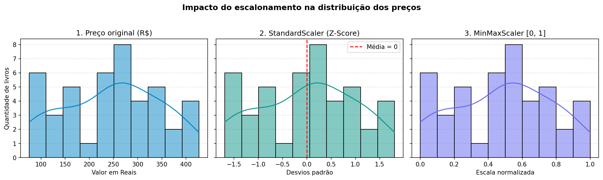
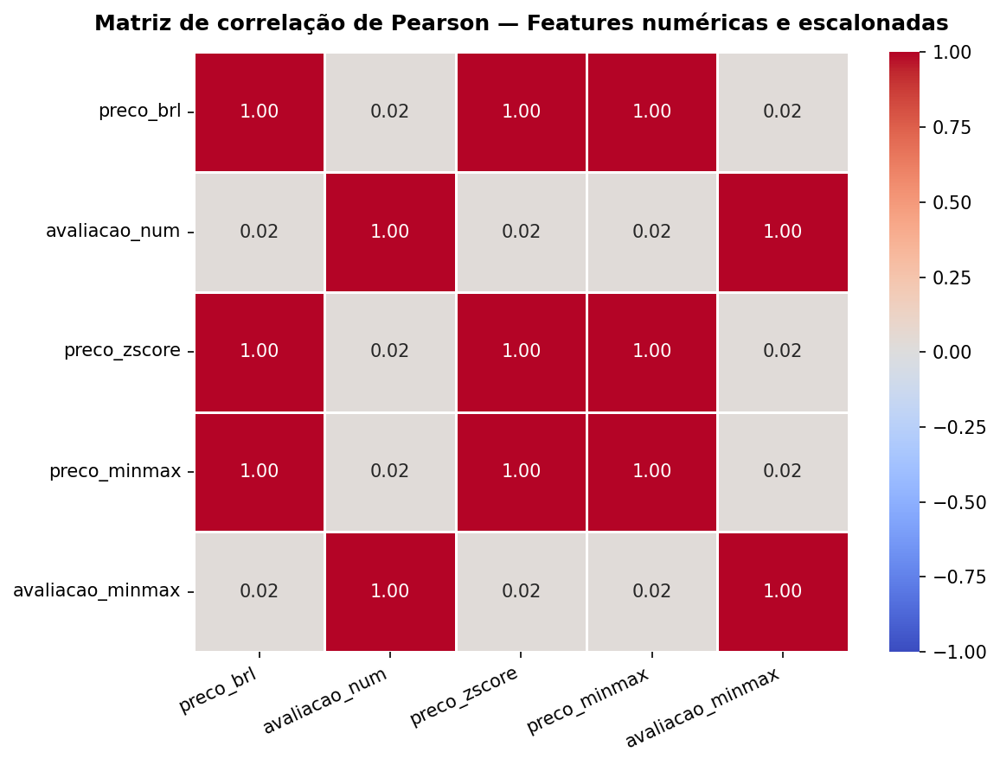
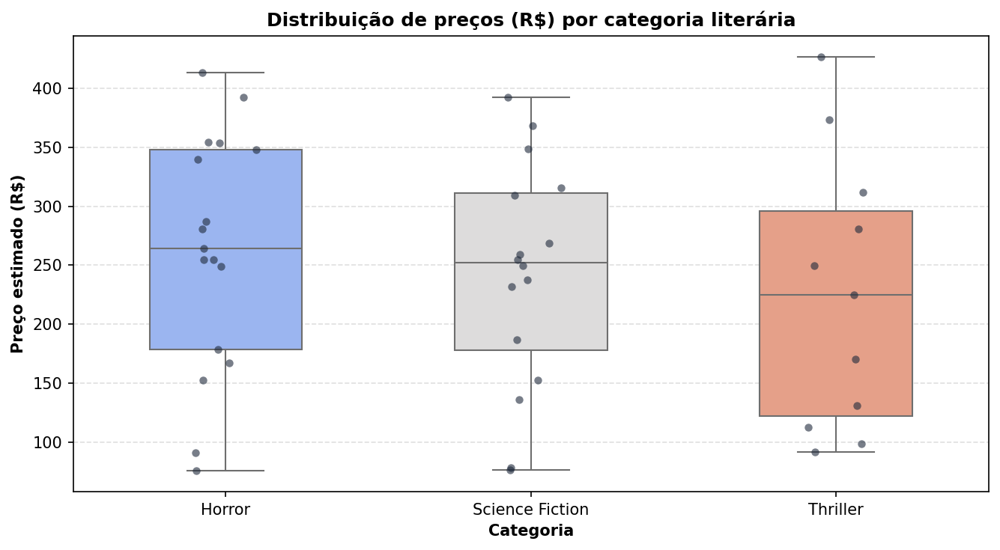
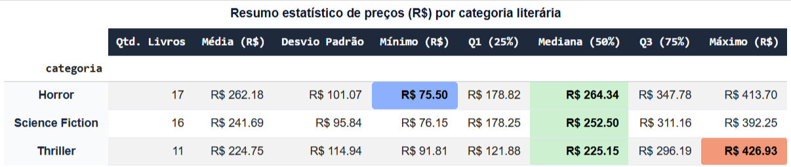
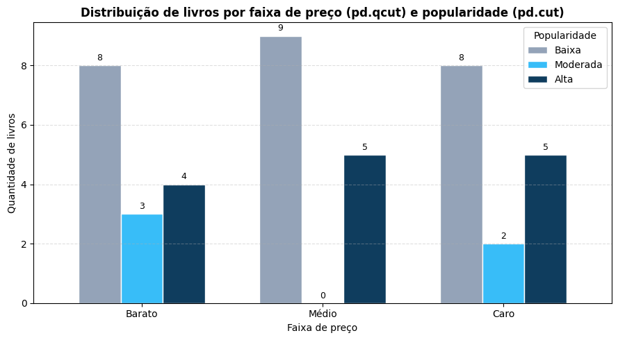

# TP3 — BookScrape ETL & ML Pipeline
## Projeto acadêmico de Ciência de Dados.
O projeto realiza a coleta automatizada de dados do catálogo [Books to Scrape](https://books.toscrape.com/), aplica higienização e *feature engineering* para deixar os dados prontos para modelos de ML, disponibiliza os registros tratados por meio de uma **API REST com FastAPI** e apresenta análises exploratórias visuais.

---

## Escopo da coleta

Foram extraídos **44 livros** distribuídos em três categorias literárias, respeitando boas práticas de *crawling* (`User-Agent` configurado, `timeout=10` e intervalo de 2 segundos entre requisições):

| Categoria | Quantidade | URL de origem |
| :--- | :---: | :--- |
| **Horror** | 17 | [Horror — Books to Scrape](https://books.toscrape.com/catalogue/category/books/horror_31/index.html) |
| **Science Fiction** | 16 | [Science Fiction — Books to Scrape](https://books.toscrape.com/catalogue/category/books/science-fiction_16/index.html) |
| **Thriller** | 11 | [Thriller — Books to Scrape](https://books.toscrape.com/catalogue/category/books/thriller_37/index.html) |
| **Total** | **44** | — |

---

## Arquitetura do pipeline

**Análise do HTML e mapeamento de seletores**
   * Inspeção da estrutura DOM (`article.product_pod`) para extração de título, preço, avaliação por estrelas, disponibilidade e URL do produto. 
     
**Fase 1 — Coleta automatizada (`dados_brutos_web.json`)**
   * Extração dos 44 registros brutos com `requests` e `BeautifulSoup4` e persistência em JSON estruturado.
     
**Fase 2 — Higienização e preparação para ML (`Model-Ready`)**
   * **Limpeza e parsing:** remoção de ruídos de codificação (`£`) via *regex*, conversão de Libra (£) para Real (R$ — taxa `7.15`), mapeamento ordinal de avaliações (`1` a `5`) e criação da flag binária `em_estoque`.
   * **Tratamento de *missing data*:** simulação controlada de 2 valores nulos (`preco_gbp` e `avaliacao_num`) seguida de imputação por **mediana** (variável contínua) e **moda** (variável ordinal).
   * **Escalonamento (*feature scaling*):** padronização Z-Score (`StandardScaler`) e normalização no intervalo `[0, 1]` (`MinMaxScaler`).
   * **Discretização (*binning*):** faixas quantílicas de preço via `pd.qcut` (`Barato`, `Médio`, `Caro`) e níveis de popularidade via `pd.cut` (`Baixa`, `Moderada`, `Alta`).
   
**Fase 3 — Exportação e API REST (`dados_modelo_pronto.csv` + `api.py`)**
   * Exportação do dataset final com **44 linhas × 13 colunas**.
   * Criação da **Books Analytics & ML-Ready API** em **FastAPI** com endpoints `GET /` e `GET /dados` (suporte a filtros por `categoria`, `faixa_preco` e `limite`), validada com `TestClient` (HTTP `200`).
     
**Fase 4 — Análise exploratória visual**
   * **Histogramas comparativos:** preservação da distribuição original após `StandardScaler` e `MinMaxScaler`.
     
   * **Matriz de correlação de Pearson:** comprovação de correlação `1.00` entre escalas de preço e ausência de correlação linear entre preço e avaliação.
<p align="center">
  
</p>

  * **Boxplot + tabela estilizada por categoria:** *Horror* apresentou a maior mediana (**R$ 264,34**) e o menor preço (**R$ 75,50**); *Science Fiction* teve mediana de **R$ 252,50** com menor dispersão; *Thriller* registrou a menor mediana (**R$ 225,15**) e a maior amplitude (até **R$ 426,93**), sem *outliers* nas três categorias.
<p align="center">
  
</p>

<p align="center">
  
</p>
  
   * **Discretização cruzada:** distribuição balanceada nos tercis de preço (**Barato**: 15, **Médio**: 14, **Caro**: 15) frente aos níveis de popularidade.
<p align="center">
  
</p>
 
---

## Estrutura do repositório

```text
├── tp3_bookscrape_etl_ml_pipeline.ipynb
├── api.py
├── boxplot.png
├── dados_brutos_web.json
├── dados_modelo_pronto.csv
├── histogramas.png
├── matriz_correlacao.png
├── preco_x_popularidade.png
├── requirements.txt
├── tabela.png
└── README.md
```
## Como executar localmente

### 1. Instalar as dependências

```bash
pip install -r requirements.txt
```
### 2. Executar o notebook

Abra o arquivo `.ipynb` no **Jupyter Notebook**, **VS Code** ou **Google Colab** e execute as células em ordem para reproduzir a coleta, o tratamento dos dados, os gráficos e os arquivos `.json`, `.csv` e `api.py`.

### 3. Subir a API FastAPI

Com o arquivo `dados_modelo_pronto.csv` gerado no mesmo diretório, inicie o servidor:

```bash
uvicorn api:app --reload
```
* Exemplo de consulta filtrada: `http://127.0.0.1:8000/dados?categoria=Thriller&faixa_preco=Caro&limite=10`

---

## Tecnologias utilizadas

* **Linguagem:** Python 3
* **Coleta web:** `requests`, `beautifulsoup4`
* **Manipulação e ML:** `pandas`, `numpy`, `scikit-learn`
* **Visualização:** `matplotlib`, `seaborn`, `Jinja2`
* **API REST:** `fastapi`, `uvicorn`, `httpx`

---
